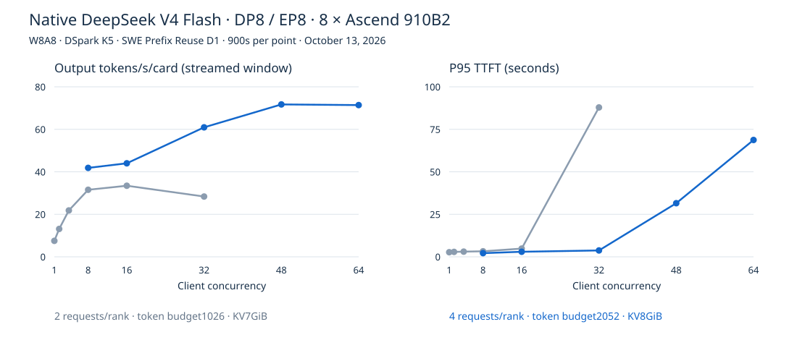

# Native DeepSeek V4 Flash: October 13 campaign

Eight Ascend 910B2 cards; TP1/DP8/EP8, W8A8, DSpark K5, APC and native async scheduling. vLLM
`ced6857` / vLLM-Ascend `5f828ad`; CANN 9.1.0. All points are 900-second SWE Prefix Reuse D1
observations; downloads were paused during measurement. No BetterScale treatment is installed.

## Observations

| Configuration                       |   C | Streamed output tok/s/card | P95 TTFT (s) | Matched output tok/s/card |
| ----------------------------------- | --: | -------------------------: | -----------: | ------------------------: |
| 2 requests/rank; budget1026; KV7GiB |   1 |                      7.516 |        2.699 |                     7.437 |
| 2 requests/rank; budget1026; KV7GiB |   2 |                     13.116 |        2.891 |                    12.868 |
| 2 requests/rank; budget1026; KV7GiB |   4 |                     21.821 |        3.045 |                    21.641 |
| 2 requests/rank; budget1026; KV7GiB |   8 |                     31.547 |        3.250 |                    29.766 |
| 2 requests/rank; budget1026; KV7GiB |  16 |                     33.447 |        4.837 |                    31.288 |
| 2 requests/rank; budget1026; KV7GiB |  32 |                     28.363 |       87.864 |                    26.646 |
| 4 requests/rank; budget2052; KV8GiB |  48 |                     71.711 |       31.535 |                    64.393 |
| 4 requests/rank; budget2052; KV8GiB |  64 |                     71.401 |       68.725 |                    60.706 |
| 4 requests/rank; budget2052; KV8GiB |   8 |                     41.849 |        2.159 |                    40.258 |
| 4 requests/rank; budget2052; KV8GiB |  16 |                     44.002 |        2.968 |                    42.198 |
| 4 requests/rank; budget2052; KV8GiB |  32 |                     60.928 |        3.744 |                    53.927 |

## Interpretation and provenance

- Four-request captures are local token buckets `[6,12,24]`, not global DP request counts: K5
  submits six query tokens per request. Two-request captures are `[6,12]`. C48/C64 exceed the
  four-request-per-rank admission width and expose queueing, not a new graph requirement.
- The 11GiB KV attempt failed startup allocation (49.62GiB allocated, 10.59GiB free); no score. The
  accepted four-request configuration uses8GiB. These are jointly tuned configurations, not
  single-parameter ablations.
- Every server passed eight exact-marker retrieval checks and a separate60s C2 warmup. Full raw
  records and owned release receipts are retained in the persistent campaign capsule; public
  projections contain timing and HTTP usage only, not generated text.
- Input/cache/output valuation uses the same completed-request cohort. Streamed-window output
  includes partial output from in-flight requests and is deliberately a separate metric. The
  projected usage files reproduce every accounting count.
- Corrected workload:248398 output-budget tokens, maximum prepared context143448; original
  eight-session360-turn SWE source. The official0731 encoder and new-runtime encoder match after
  schema adapters preserve reasoning and tool argument strings. See encoder-qualification.json.
  Earlier reasoning-omitted attempts are excluded for incorrect workload serialization, not their
  scores.
- This is not an exact reproduction of the September runtime/prepared artifact. Preserve the
  historical Frontier data separately. Cross-model comparisons use model-specific
  serialization/tokenization and do not establish quality equivalence.
- Current official DeepSeek pricing refers to V4.1 Flash, not this0731 checkpoint. No current
  same-model API price or profit claim is attached; serving-plan price assumptions remain to be
  agreed.
