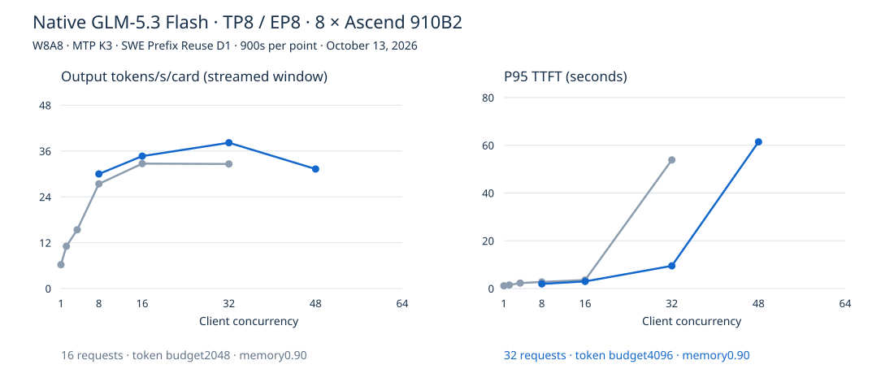

# Native GLM-5.3 Flash

## Observations

Two native TP8/EP8 W8A8 configurations; MTP3 eager draft and FULL_DECODE_ONLY target. Ten900s
windows C1–C48, all zero failures; eight exact-marker checks and separate60s warmup preceded each
configuration. All eight Ascend910B2 cards count in the denominator.

Narrow: max_num_seqs16, budget2048. Wide: max_num_seqs32, budget4096. Both use automatic KV sizing
at memory utilization0.90, max context147456. The wider client metadata was corrected against the
preserved launcher and startup log; no metrics changed.

The projected usage files reproduce matched completed-request accounting. Full logs and raw streams
remain in the persistent campaign capsule. This is not model quality testing.
